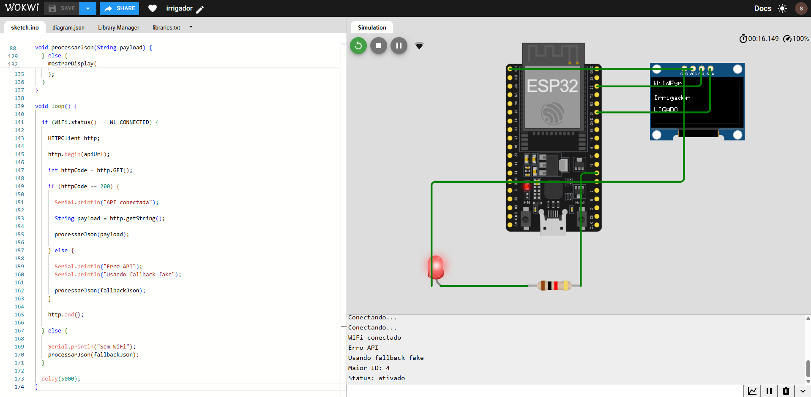

# Windfyr API

API para monitoramento de focos de incendio, previsao de risco e irrigacao automatizada.

## Arquitetura

Projeto organizado em camadas:

- `Windfyr.WebApi`: apenas endpoints/controle e mapeamento de HTTP.
- `Windfyr.Domain`: entidades e use cases (regras de negocio, inputs/outputs).
- `Windfyr.Repository`: acesso a dados (EF Core).
- `Windfyr.Http`: integracoes externas (OpenWeather).

## Requisitos

- .NET SDK 10
- MySQL

## Configuracao

Crie um arquivo `.env` na raiz do projeto com:

```
ConnectionStrings__DefaultConnection=Server=localhost;Port=3306;Database=windfyr;User=root;Password=senha;
JWT__Key=chave-com-no-minimo-32-caracteres
JWT__Issuer=windfyr-api
JWT__Audience=windfyr-client
JWT__ExpiresInMinutes=60
OPENWEATHER__APIKEY=sua-chave
OPENWEATHER__BASEURL=https://api.openweathermap.org
```

## Como rodar

1) Aplicar migrations

```
dotnet ef database update --project Windfyr.Repository --startup-project Windfyr.WebApi
```

2) Iniciar a API

```
dotnet run --project Windfyr.WebApi
```

3) Acessar o Swagger (Documentacao API)

Com a API em execucao, abra:

```
http://localhost:5081/swagger/index.html
```

Obs.: a porta pode variar conforme o `launchSettings.json`.

## Endpoints

### Auth

- `POST /api/auth/register`
- `POST /api/auth/login`

### User

- `GET /api/users/me`
- `PUT /api/users/me`

### Crops

- `GET /api/crops`

### Lands

- `GET /api/lands`
- `GET /api/lands/{id}`
- `POST /api/lands`
- `PUT /api/lands/{id}`
- `DELETE /api/lands/{id}`
- `GET /api/lands/{id}/forecast`

## Comportamento do endpoint /api/lands

O endpoint `GET /api/lands` faz automaticamente, para cada terreno do usuario autenticado:

1) Atualizacao de dados climaticos:
consulta a OpenWeather por latitude/longitude do terreno.

2) Atualizacao de forecast:
calcula o risco de incendio com base em temperatura, umidade e pressao.
Se os valores mudaram em relacao ao ultimo registro, cria um novo item em `forecast_histories`.

3) Atualizacao de irrigacao:
define o estado do irrigador com base no risco calculado.
- risco > 80%: ativado
- risco <= 80%: desativado
Se o estado mudou em relacao ao ultimo historico, cria um novo item em `irrigation_histories`.

4) Simulacao da automacao do irrigador:
a automacao do irrigador também pode ser simulada no Wokwi: https://wokwi.com/projects/465189225880013825

o ESP32 consulta o endpoint e identifica o registro em irrigation_histories mais recente e, conforme o status retornado, ativa ou desativa o irrigador simulado, representado por um LED e por mensagens exibidas em tempo real no display.

## Seguranca

- Senha com minimo de 6 caracteres.
- Senha armazenada com hash usando BCrypt.
- Confirmacao de senha na criacao e atualizacao.
